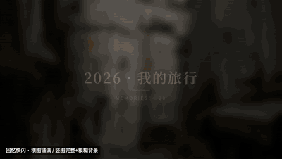
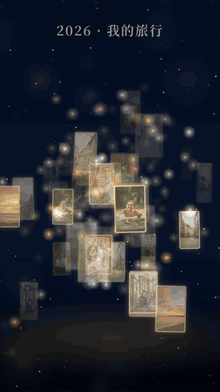
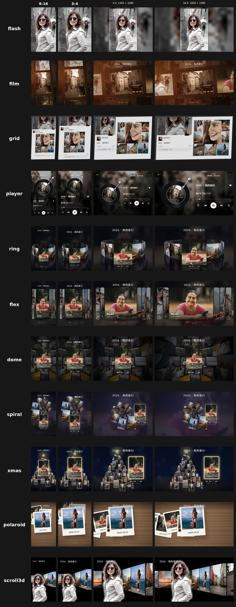
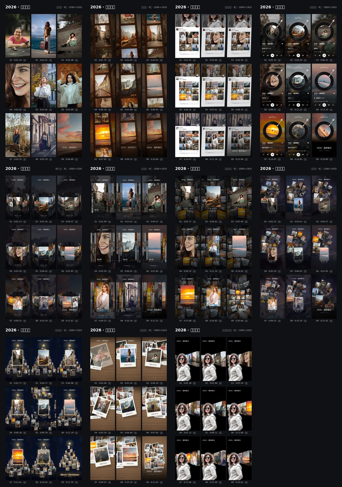
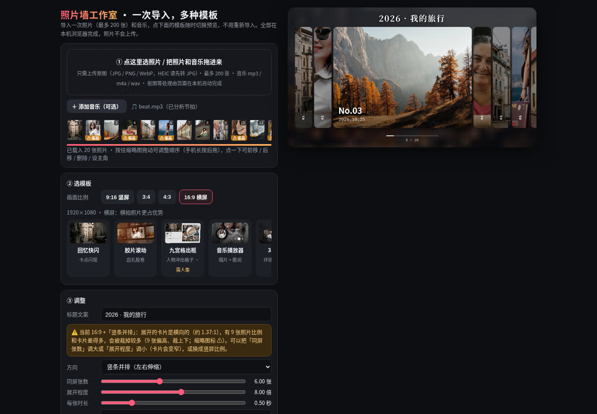
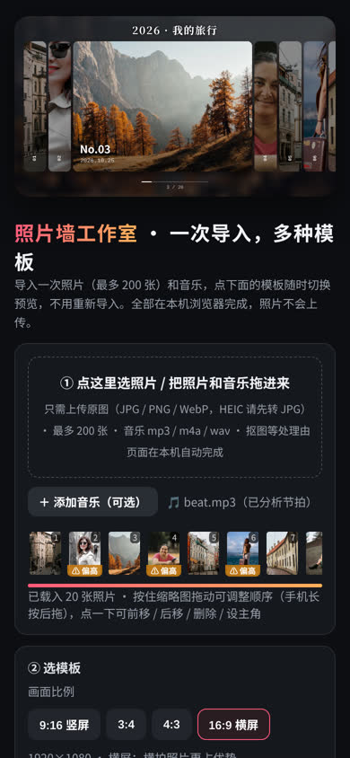
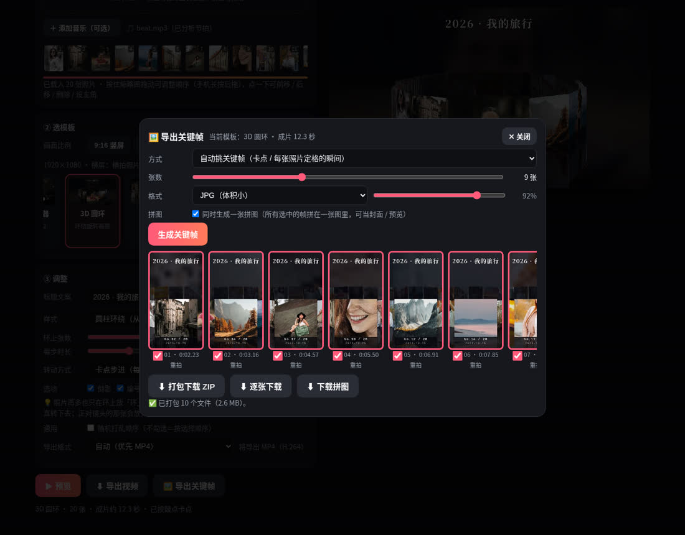
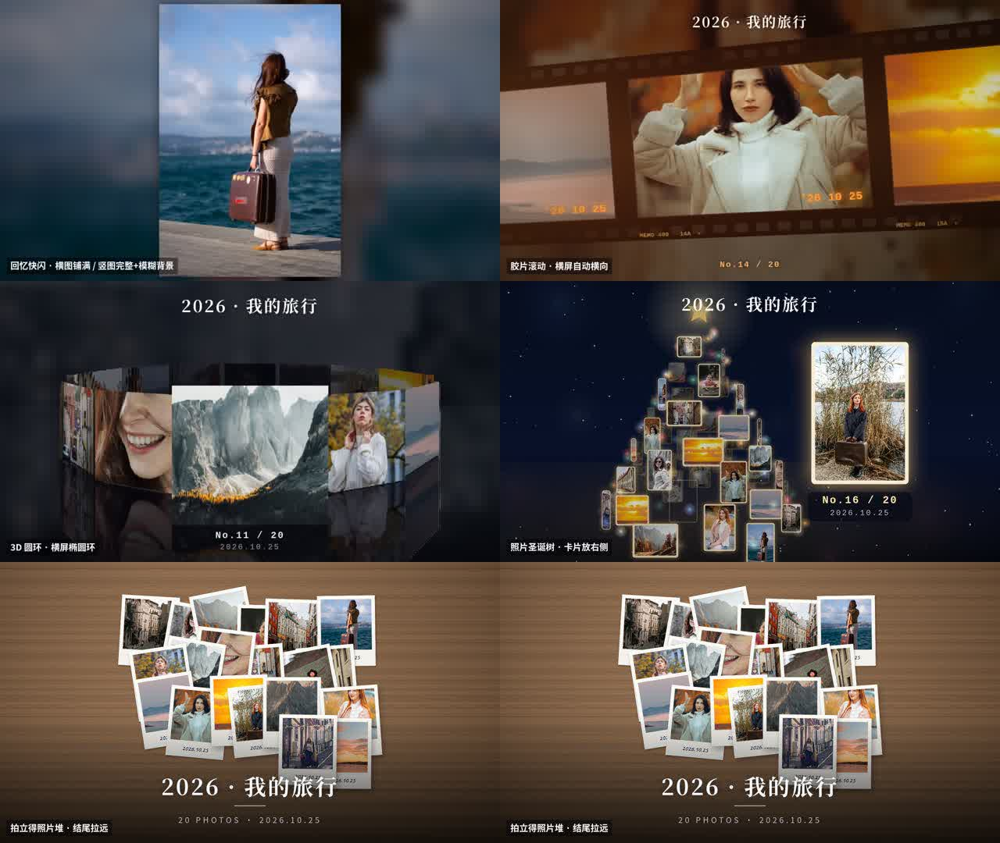

# Photo Wall Studio · 照片墙

**在线使用 / Live:** https://booom711.github.io/photo-wall-studio/ · **样片 / Demo videos:** [Release v1.0.0](https://github.com/Booom711/photo-wall-studio/releases/tag/v1.0.0)

---

## 中文

**照片墙工作室**是一个**本地优先**的网页应用：一次导入最多 200 张照片和一段音乐，选模板就能生成**卡点照片墙视频**，直接导出 MP4（或 WebM）和关键帧图片。所有用户素材处理（抠图、缩图、节拍分析、渲染、编码）都在浏览器本地完成，**照片不会上传到任何地方**。页面在导入前会用随项目发布的手绘示例图展示模板与成片效果。

### 11 个模板
| # | 模板 | 一句话说明 |
|---|---|---|
| 1 | 回忆快闪 | 跟着鼓点一张张闪现，5 种转场（缩放白闪 / 黑闪 / 滑动 / 震屏 / RGB 分离） |
| 2 | 胶片滚动 | 齿孔胶卷带着照片卡点步进，暖色颗粒、漏光、日期戳 |
| 3 | 九宫格出框 | 朋友圈九宫格，中间那张的人物自动抠出来“冲出格子” |
| 4 | 音乐播放器 | 旋转黑胶 / 方形封面 + 卡拉 OK 歌词，一句歌词一张照片 |
| 5 | 3D 圆环 | 照片围成 3D 圆环（圆柱 / 全景 / 摩天轮），卡点转动，带倒影 |
| 6 | 伸缩卡片 | 当前那张展开、其余压成细条，随鼓点往后走 |
| 7 | 球幕照片墙 | 照片铺满球面缓慢旋转，鼓点时一张飞出放大（预览可拖动） |
| 8 | 无限螺旋 | 照片沿 3D 螺旋向深处延伸，镜头穿行（漩涡 / 螺旋塔） |
| 9 | 照片圣诞树 | 发光照片卡片组成旋转圣诞树，星星、下雪、散开再聚拢 |
| 10 | 拍立得散落 | 拍立得一张张掉到桌面堆起来，手写日期，结尾拉远看全貌 |
| 11 | 立体滚动照片墙 | 照片连成长条贴在“折叠墙”上（左远右近的透视），匀速滚动、首尾无缝循环；左侧自动抠出的人物主角带白色柔光挡住折缝（同剪映「播放器 III」效果）。可选 1–3 排（相邻反向）、折角、透视强度、整体倾斜、间距、背景色、鼓点脉动 |

### 功能
- **只需上传原图**：缩图、抠图等全部在页面里自动完成；HEIC 请先转 JPG。
- **页面内自动抠人像**（内置 MediaPipe Selfie Segmenter 模型，手写 JS 推理，本机运行）；不满意可用笔刷修补或上传透明 PNG。
- **先看效果再上传**：12 张手绘示例图会自动填入全部模板卡片和成片预览；上传真实照片后一次性替换示例素材。
- **排序与多选**：点按缩略图多选，拖到另一张照片的位置即可换位；选中边框、落点反馈和拖动阻尼让操作更明确，手机支持长按后拖。
- **卡点**：自动分析音乐节拍，换图 / 闪白 / 转动都卡在鼓点上；没有音乐也能用。
- **4 种画面比例**：9:16（1080×1920）、16:9（1920×1080）、3:4（1080×1440）、4:3（1440×1080）。每个模板都会按横竖屏**重新排版**，不是拉伸或加黑边；比例会被记住。
- **按需提示**：某个模板需要额外条件时（如九宫格要有人的照片、伸缩卡片里照片会被裁多），会指出具体哪几张、怎么改。
- **导出视频**：MP4（H.264，优先）或 WebM，带音乐；文件名带模板名和比例。
- **导出关键帧**：当前画面或自动挑选 N 张关键帧（优先鼓点 / 转场时刻），PNG / JPG，单张下载、打包 ZIP、一张拼图（contact sheet），iPhone 可用“分享 / 存到相册”。
- 手机上也能打开和预览；导出视频建议用电脑。

### 使用方法
1. 打开 https://booom711.github.io/photo-wall-studio/ ，先切换模板或点「▶ 预览」查看默认手绘样片。
2. 「01 导入素材」导入原图（最多 200 张），可选「添加音乐」（mp3 / m4a / wav）；真实照片会替换默认样片。
3. 在「02 选择模板」直接选模板；画面比例在「03 调整效果」的下拉列表中选择。
4. 点按照片可多选；把照片直接拖到目标照片的位置即可换位，选择后可删除。
5. 调整标题、节奏和模板样式，点「▶ 预览」。
6. 上传真实照片后可点「保存视频」或「导出关键帧」。录制期间保持页面在前台。

### 浏览器建议
- **推荐：电脑版 Chrome / Edge 最新版**（能直接导出 MP4 H.264）。
- Safari 可用；Firefox 只能导出 WebM（发抖音前可用剪映 / 格式工厂转 MP4）。
- 手机浏览器适合预览和导出关键帧；长视频导出建议用电脑。

### 已知限制
- 导出视频是**实时录制**（成片多长就录多长），录制时请保持标签页在前台、不要切走；录制中不能切换比例。
- 最多 200 张照片；照片很多时九宫格 / 拍立得结尾里每张会比较小。
- 抠图只针对**人像**；九宫格出框需要每组里有人的照片，否则退化为椭圆贴纸效果。
- 只支持这 4 种比例，没有自定义尺寸；换比例是换版式，不会智能识别主体来裁图。
- 预览播放时导出关键帧会慢一些。
- 圣诞树模板的摄像头手势只用于预览，不进入导出视频。
- 不支持 HEIC（请先转 JPG）。

### 预览
四种比例 × 11 个模板：

关键帧拼图（9:16）：

界面（电脑 / 手机 / 关键帧导出）：

 

16:9 样片抽帧：

### 作为 Agent Skill 使用
`skill/photo-wall-studio/` 是一个可分发的 Agent Skill（含 `SKILL.md`、页面和默认示例素材），复制整个目录到 skills 目录即可让 AI 助手指导用户做照片墙视频。

---

## English

**Photo Wall Studio** is a **local-first** web app. Import up to 200 photos and an optional song, pick a template, and get a **beat-synced photo-wall video**, exported as MP4 (or WebM) plus key-frame images. User media processing — cut-out, resizing, beat detection, rendering and encoding — runs locally in your browser; **photos are never uploaded**. Before import, bundled hand-drawn demo images show the real template and final-preview effects.

### 11 templates
| # | Template | One-liner |
|---|---|---|
| 1 | Memory Flash (回忆快闪) | Photos flash on the beat with 5 transitions (zoom+flash, black, slide, shake, RGB split) |
| 2 | Film Roll (胶片滚动) | Sprocket film strip stepping on the beat, warm grain, light leaks, date stamp |
| 3 | 3×3 Pop-out (九宫格出框) | Social-feed 3×3 grid; the person in the center photo is auto cut out and pops out of the frame |
| 4 | Music Player (音乐播放器) | Spinning vinyl / square cover with karaoke lyrics, one line per photo |
| 5 | 3D Ring (3D 圆环) | Photos on a 3D ring (cylinder / panorama / ferris wheel) rotating on the beat, with reflections |
| 6 | Flex Cards (伸缩卡片) | Current card expands, others collapse into strips, advancing on the beat |
| 7 | Dome Gallery (球幕照片墙) | Photos tiled on a slowly rotating sphere; one flies out on each beat (draggable in preview) |
| 8 | Infinite Spiral (无限螺旋) | Photos along a 3D spiral into depth with a fly-through camera (vortex / tower) |
| 9 | Photo Christmas Tree (照片圣诞树) | Glowing photo cards form a rotating tree with star, snow, scatter-and-regather |
| 10 | Polaroid Pile (拍立得散落) | Polaroids drop and pile up on a table with handwritten dates; ending pulls back to the whole pile |
| 11 | 3D Scrolling Wall (立体滚动照片墙) | A continuous photo strip on a folded wall in perspective (far on the left, near on the right) scrolls at constant speed as a seamless loop; an auto cut-out hero with a soft white glow hides the fold (like CapCut's "Player III" effect). 1–3 rows (adjacent rows opposite), fold angle, perspective, tilt, gap, background, optional beat pulse |

### Features
- **Upload originals only** — thumbnails and cut-outs are generated in the page. (Convert HEIC to JPG first.)
- **In-page person cut-out** (embedded MediaPipe Selfie Segmenter weights, hand-written JS inference, local); fix with a brush or upload a transparent PNG.
- **Preview before upload** with 12 bundled hand-drawn demo images across all template cards and the main canvas; importing real photos replaces the demos.
- **Multi-select and reorder**: click/tap thumbnails to select, then drag a photo directly onto another photo to swap them; phones support long-press and drag.
- **Beat sync**: music is analyzed automatically; cuts/flashes/rotations land on beats. Works without music too.
- **4 aspect ratios**: 9:16 (1080×1920), 16:9 (1920×1080), 3:4 (1080×1440), 4:3 (1440×1080). Each template **re-lays out** for portrait/landscape (no stretching/letterboxing). The choice is remembered.
- **Contextual notices** tell you which photos need attention for the current template/ratio and how to fix it.
- **Video export**: MP4 (H.264, preferred) or WebM, with audio.
- **Key-frame export**: current frame or N auto-picked key frames (beats/transitions preferred), PNG/JPG, single files, ZIP, contact sheet; "Share / Save to Photos" on iOS.

### How to use
1. Open https://booom711.github.io/photo-wall-studio/ and switch templates or press ▶ Preview to inspect the built-in sample effects.
2. Import original photos (≤200) and optionally a song (mp3/m4a/wav); real photos replace the demos.
3. Pick a template above the main preview. Choose the aspect ratio from the dropdown under ③ Adjust.
4. Multi-select thumbnails or drag one directly onto another to swap them; follow contextual notices when needed.
5. Tweak title, timing and template style, then preview.
6. After importing real photos, click Save Video or Export Key Frames. Keep the tab in the foreground while recording.

### Browser recommendations
- **Best: latest desktop Chrome / Edge** (direct MP4/H.264 export).
- Safari works; Firefox exports WebM only.
- Mobile browsers are fine for preview and key frames; use a desktop for long video exports.

### Known limits
- Video export is **real-time recording** (an N-second video takes N seconds); keep the tab visible; the ratio can't be changed while recording.
- Max 200 photos; with many photos, each photo becomes small in the grid/polaroid endings.
- Cut-out targets **people** only; the 3×3 pop-out needs a photo with a person in each group of 9, otherwise it falls back to an oval sticker.
- Only the 4 ratios above; no smart subject-aware cropping.
- Key-frame export is slower while preview is playing.
- Webcam gestures (Christmas tree) are preview-only.
- HEIC is not supported.

### Use as an Agent Skill
`skill/photo-wall-studio/` is a distributable Agent Skill containing `SKILL.md`, the page and its bundled demo assets. Copy the whole folder into your agent's skills directory.

### Repository layout
- `index.html` — the app (served by GitHub Pages)
- `skill/photo-wall-studio/` — distributable agent skill
- `docs/img/` — preview images
- `tools/seg/` — segmentation model converter / reference checks; `tools/render/` — headless-Chrome scripts used to render demos (paths need adapting)

### License
Own code: MIT (`LICENSE`). Embedded third-party components keep their licenses — see `THIRD_PARTY_NOTICES.md`.
